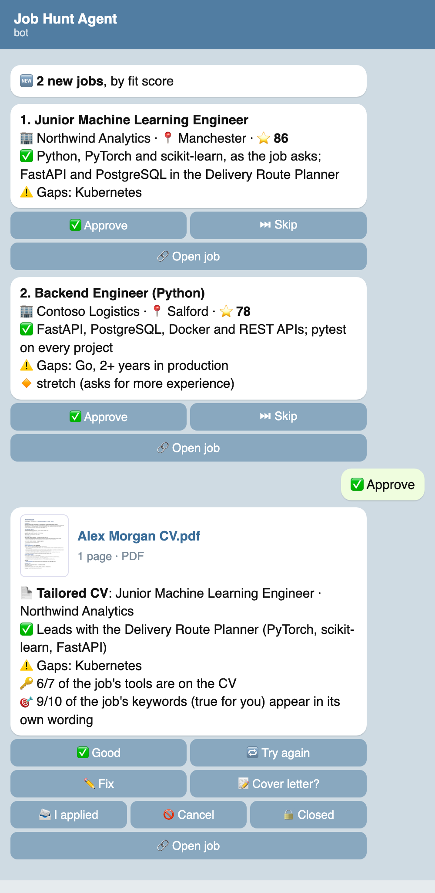
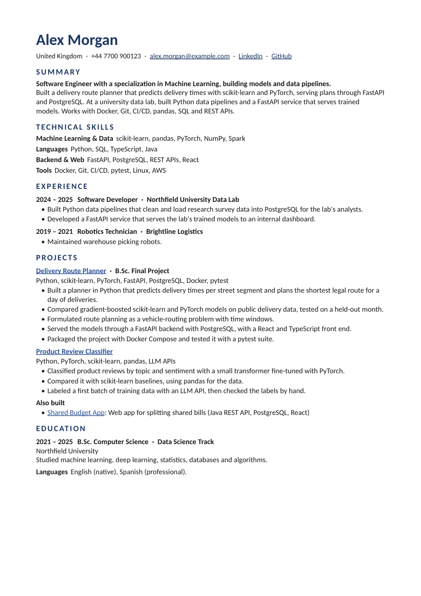

# Job Hunt Agent

[](https://github.com/YuvalGarzon/job-hunt-agent/actions/workflows/tests.yml)
[](https://github.com/YuvalGarzon/job-hunt-agent/releases/latest)
[](LICENSE)


A personal job-search agent that runs on your own computer (macOS, Windows or Linux). It watches company career pages and your
job-alert emails, sends you the jobs that fit you on Telegram, and builds a one-page CV
tailored to each job you approve: written only from facts you gave it, checked by code
before you ever see it.

<p align="center">
  
  &nbsp;
  
</p>
<p align="center"><sub>Left: job cards on Telegram, and the CV sent after ✅ Approve. Right: that CV, tailored for a made-up person, Alex Morgan, to a "Junior Machine Learning Engineer" posting.</sub></p>

## What it does

- **Finds jobs.** Every 15 minutes it reads the public job boards of the companies you watch
  (Greenhouse, Lever, Ashby, Comeet, Workday, Workable, Recruitee, SmartRecruiters, and the
  career sites of Microsoft, Amazon, Google and Apple), plus your LinkedIn and other job-alert
  emails in Gmail. Every day it asks Claude to find more companies near you, and finds the job
  board each one's careers page uses. Each card links to the job's own page.
- **Filters and scores them.** It drops jobs that are too senior, too far from home, not the
  type you want, or look like scams, and gives the rest a 0-100 fit score against your
  profile. Every decision has a written reason.
- **Sends you the good ones on Telegram**, best first, each as a card with ✅ Approve / ⏭ Skip.
  Skips teach it: skip for "company" and that company is gone; skip for "location" and that
  city scores lower.
- **Builds a tailored CV** when you tap Approve: Claude tailors your general CV to the posting
  in the posting's own words, then code checks every line against your profile (no invented
  tool, number, title or link), renders a one-page PDF, and checks every link is public.
  You can ask for changes in your own words.
- **Helps you apply**: cover letters, answers to application-form questions (with a bank of
  your saved answers), interview prep with a study plan, mock interviews, and a free chat
  about your search.
- **Tracks your applications** in a Google Sheet: it reads company replies in Gmail (received,
  assessment, interview, rejection, offer), updates each status, reminds you to follow up
  after 7 days, and sends a daily summary.

You do the applying yourself: the agent never sends anything to a company, and it can only
send email to you.

## How it works

```
 company job boards ─┐                                      ┌─> Telegram card ── ✅ Approve ──> tailored CV (PDF)
 LinkedIn alerts ────┼─> filters ─> fit score ─> threshold ─┤                                    │
 other alert emails ─┘   (level, place,            (you set) └─> Google Sheet <── status updates <─┘ <── company replies (Gmail)
                          job type, scams)
```

- **Your computer** runs a background worker (it starts when you log in): it answers Telegram, runs Claude
  Code for the writing, renders the CVs, and searches.
- **Claude Code** (headless, on your own plan) does the writing and reading: CVs, letters,
  answers, reading job-alert emails and screenshots. Code checks everything it writes.
- **A Google Sheet** is the agent's memory and your application tracker.
- **Your files stay on your computer.** Your profile and settings are never committed, and your
  keys live in your system's keychain.

## What you need

- A computer with **macOS, Windows or Linux** and [Python](https://www.python.org/downloads/) 3.11 or newer.
  Tested on macOS; Windows and Linux are supported but not yet tested (an issue report helps).
- [Claude Code](https://claude.com/claude-code) installed and signed in (a Claude plan that includes it)
- A Telegram account
- A Google account (for the Sheet and Gmail; a free Google Cloud project, no billing needed)
- Your current CV as a PDF
- About 30 minutes for the setup

## Setup

### 1. Get the code

**macOS / Linux** (in Terminal):

```bash
git clone https://github.com/YuvalGarzon/job-hunt-agent.git
cd job-hunt-agent
python3 -m venv .venv
source .venv/bin/activate
pip install -r requirements.txt
```

**Windows** (in PowerShell):

```powershell
git clone https://github.com/YuvalGarzon/job-hunt-agent.git
cd job-hunt-agent
py -m venv .venv
.venv\Scripts\Activate.ps1
pip install -r requirements.txt
```

The CVs are made into PDFs with [WeasyPrint](https://doc.courtbouillon.org/weasyprint/stable/first_steps.html),
which needs one system library besides Python:

- **macOS:** nothing more (if a PDF fails, `brew install pango`).
- **Linux:** the Pango library, e.g. `sudo apt install libpango-1.0-0 libpangoft2-1.0-0` on Ubuntu/Debian.
- **Windows:** install GTK as the [WeasyPrint Windows guide](https://doc.courtbouillon.org/weasyprint/stable/first_steps.html#windows) explains.

On Linux, the keys are kept by your desktop's keyring (GNOME Keyring or KWallet), so use a
desktop session, not a bare server.

Every command below is run in the project folder with the environment active
(`source .venv/bin/activate` on macOS / Linux, `.venv\Scripts\Activate.ps1` on Windows).

### 2. Run the setup wizard

```bash
python setup.py
```

It goes step by step and asks before each one. You can stop at any time (Ctrl+C) and run it
again: finished steps are marked ✓, and you can redo any single step later, e.g.
`python setup.py search`.

| Step | What it asks or does |
|---|---|
| **1. About you** | Name, email, phone, LinkedIn, GitHub, website; the country you search in, your home city, how far you'll travel, your time zone. The home city is used only to measure distance and is never written anywhere. |
| **2. Your profile** | Reads your CV PDF with Claude and drafts `PROFILE.yaml`: education, skills, experience, projects and CV rules. It shows you each part and asks if it's right; anything wrong opens in your text editor. |
| **3. The jobs you want** | The roles you want most and the ones you'd also take; your level (junior / mid / senior) and the most years of experience a job may ask for; words that mark your specialty; words that rule a job out; part-time, contract or internship too; remote jobs or not; companies to avoid and companies you'd love to work for; how high a score a job needs; the languages for cover letters. |
| **4. Telegram** | Connects your bot (see below) and sends you a hello. |
| **5. Google Sheet** | Connects the Sheet (see below) and sets up its tabs. |
| **6. Gmail** | Signs you in to Gmail (see below). |
| **7. Job alerts** | Which job-alert emails to read: LinkedIn, and any other job site that emails you alerts. |
| **8. Companies** | Shows the starter list of large companies (remove any you don't want), lets you add the companies you want by pasting their careers page link or name, and asks Claude to find more tech companies near you. |
| **9. Your general CV** | Builds your general CV from your profile, the one every tailored CV starts from, and opens it. |
| **10. A first search** | Searches right away, so the first job cards arrive on Telegram. |
| **11. Background worker** | Installs the worker so the agent runs whenever your computer is awake: a launchd agent on macOS, a systemd user service on Linux, a Task Scheduler task on Windows. |

### Connecting everything (what the wizard walks you through)

<details>
<summary><b>Claude Code</b></summary>

Install Claude Code from [claude.com/claude-code](https://claude.com/claude-code), then run
`claude` once in a terminal and sign in. The agent calls it headlessly (`claude -p`) with
the model and effort in `settings.yaml` (`worker:`), on your own plan. If your plan hits a
usage limit, the agent stops and tells you on Telegram; it never switches to another model.
</details>

<details>
<summary><b>Telegram bot</b></summary>

1. In Telegram, open **@BotFather**, send `/newbot`, and pick a name and a username ending in `bot`.
2. Copy the token BotFather gives you and paste it into the wizard (input is hidden).
3. Open your new bot and send it any message: the wizard finds your chat ID from it.

The bot answers only your own chat; messages from anyone else are ignored.
</details>

<details>
<summary><b>Google Sheet (service account)</b></summary>

1. Open the [Google Cloud console](https://console.cloud.google.com/) and create a project (any name).
2. Enable the [Google Sheets API](https://console.cloud.google.com/apis/library/sheets.googleapis.com).
3. **IAM & Admin › Service Accounts › Create service account** (any name, no roles needed).
4. Open it › **Keys › Add key › Create new key › JSON**. It downloads to `~/Downloads`; the
   wizard moves it into your system's keychain and deletes the file.
5. Create a new Google Sheet ([sheets.new](https://sheets.new)), click **Share**, and add the
   service account's email (the wizard shows it) as **Editor**.
6. Paste the Sheet's URL into the wizard.

The Sheet's visible tab, **My Applications**, is your tracker; the agent's own tabs are hidden.
</details>

<details>
<summary><b>Gmail</b></summary>

In the same Google Cloud project:

1. Enable the [Gmail API](https://console.cloud.google.com/apis/library/gmail.googleapis.com).
2. **APIs & Services › OAuth consent screen**: choose *External*, and add your own Gmail
   address as a *Test user*.
3. **Credentials › Create credentials › OAuth client ID › Desktop app**, and download the JSON
   to `~/Downloads`.
4. The wizard runs `scripts/gmail_auth.py`: a browser opens, you sign in and allow read,
   send and modify access.

The agent reads your mail only to find job alerts and replies from companies you applied to,
and it can only send email to your own address. The modify access is used for one thing: the
job-alert emails it has read are marked as read, so unread alerts in your inbox don't look like
jobs you missed. It never deletes, moves or archives mail. If you signed in before this was
added, run `python scripts/gmail_auth.py` once more; until then the emails stay unread and
everything else works. While the OAuth app is in *Testing*, Google
ends the sign-in after 7 days; the agent reminds you on Telegram to run
`python scripts/gmail_auth.py` again. To stop that, publish the app (**OAuth consent
screen › Publish app**) and sign in once with `scripts/gmail_auth.py --production`.
</details>

<details>
<summary><b>Companies to watch</b></summary>

Paste a company's careers page link (or just its name) into the wizard, or send it to the bot
later with `/company <link or name>`. The agent finds which job system the company uses
(Greenhouse, Lever, Ashby, Comeet, Workday, Workable, Recruitee or SmartRecruiters), reads its
board once, and tells you how many
open jobs it has in your country; from then on it is read every run.

- A board link works best: `https://boards.greenhouse.io/<company>`, `https://jobs.lever.co/<company>`,
  `https://jobs.ashbyhq.com/<company>`, `https://<company>.wd5.myworkdayjobs.com/<site>`.
- A company's own careers page works when it links to or embeds its job board and its robots.txt
  allows automatic reading. Pages that load their jobs with JavaScript are opened once in headless
  Chrome or Chromium, when one is installed.
- A name works when the company's board uses its name (e.g. "Datadog").
- Microsoft, Amazon, Google and Apple are read through their own career sites (in the starter list).
- A company on another job system can't be watched directly; its jobs can still reach you
  through LinkedIn or job-board alert emails. Companies the scout finds but can't read yet are
  checked again every two weeks.

You can also edit `companies.yaml` by hand (its top explains the format). Every day at 11:00
the agent's company scout suggests more companies near you on Telegram.
</details>

<details>
<summary><b>Job-alert emails</b></summary>

- **LinkedIn:** on linkedin.com/jobs, search for your role and place, turn on **Set alert**, and
  choose email. The agent reads the alerts from `jobalerts-noreply@linkedin.com`.
- **Any other job site** that emails you alerts: give the wizard the site's name and the sender
  address (open one of its alert emails to see it). Claude reads these emails.

The agent never opens LinkedIn or the job sites themselves. A job from an alert is matched to
the company's own careers page when it can be found there; otherwise it is sent tagged "not
verified on the company site".
</details>

## Using it

Everything happens in your Telegram chat with the bot. The **☰ Menu** button lists the commands.

| You send | The agent |
|---|---|
| *(nothing)* | sends new jobs as cards, best fit first: ✅ Approve, ⏭ Skip, 🔒 Closed |
| ✅ **Approve** on a card | builds a tailored CV and sends the PDF with ✅ Good, 🔁 Try again, ✏️ Fix, 📝 Cover letter, 📨 I applied |
| a link, a forwarded post, a screenshot, a PDF or Word file of a job | reads it, finds it on the company's site, and sends it as a card |
| `/cv` + a job | goes straight to a tailored CV |
| `/answer` + a form question (text or screenshot) | writes an answer, reusing answers you saved |
| `/prep <company>` | interview prep with likely questions, your best stories and a study plan; then 🎤 Mock interview |
| `/open` | the jobs you haven't handled yet, and the CVs waiting for you to apply |
| `/company <link or name>` | starts watching that company's job board |
| `/threshold <number>` | the fit score a job needs to be sent to you |
| `/mail` | checks your email now |
| `/status`, `/today`, `/sources` | how the agent is doing |
| `/pause`, `/resume` | stops and restarts the search |
| `/skipped` | jobs you skipped, to bring one back |
| any other message | a free chat about your search, or a Reply to any message to talk about it |

Every day: at 09:00 the jobs still waiting for you, at 11:00 new companies the scout found,
at 18:00 a summary of the day, and at 22:00 (on days you applied) an email listing those applications.

CVs are saved under `CVs/<Role> CV/<Company> - <Title> - <date>/` in the project folder, with
earlier versions in `_versions/`.

## Your files

The wizard creates these in the project folder. They are listed in `.gitignore` and are never
committed. Edit them any time; the agent reads them on its next run.

| File | What it holds | Example |
|---|---|---|
| `PROFILE.yaml` | **The only source of facts about you.** Contact details, education, skills (strong / used), experience with its approved bullets, projects with their facts, and your CV rules: the titles you can claim, your specialty, which project leads which kind of job, words never to write. | [`examples/PROFILE.example.yaml`](examples/PROFILE.example.yaml) |
| `settings.yaml` | How to search: country, home point and radius, level, roles, job types, remote, companies to avoid or prefer, alert emails, the Claude model. | [`examples/settings.example.yaml`](examples/settings.example.yaml) |
| `companies.yaml` | The companies whose job boards are read every run (`/company` and the scout add more in the Sheet's Boards tab). | [`examples/companies.example.yaml`](examples/companies.example.yaml) |
| `base_cv.yaml` | Your general CV, the starting point of every tailored CV. | [`examples/base_cv.example.yaml`](examples/base_cv.example.yaml) |

Keys and tokens (Telegram, Google, Gmail) are stored in your system's keychain (macOS Keychain,
Windows Credential Manager or the Linux Secret Service) under
`job-hunt-agent`, never in a file. Logs are in `~/.job-hunt-agent/logs/`.

### How the CV stays true

Every CV goes through these checks before you see it; a failing CV goes back to Claude to fix,
and is never sent:

1. **Truth check** (`agent/truth_check.py`): every skill, number, project, link and title must
   be in `PROFILE.yaml`; experience bullets are copied word for word from the approved ones; no
   banned or forbidden words, no home city, no tech term you don't have.
2. **One page**: too long, and it is shortened (wording, then fewer bullets), never squeezed.
3. **Links**: every link is from your profile, sits on the right word, and is public.
4. **Visual check**: nothing outside the margins, every line present.

## Optional: cloud mode

The worker on your computer is the main way to run the agent. If you want the search to go on
while your computer sleeps, a GitHub Actions workflow (`.github/workflows/job-hunt-agent.yml`)
can run the search and answer Telegram in the cloud (CV building waits for your computer).

1. Use a **private** copy of this repo: Actions logs of a public repo are public.
2. Copy your keys and files to its GitHub Secrets: `python scripts/push_secret.py --all`
   (needs the [GitHub CLI](https://cli.github.com/), signed in).
3. In the workflow file, remove the `#` in front of the `schedule:` lines and push.

GitHub's free plan includes 2,000 Actions minutes a month; the agent warns you on Telegram at 80%.

## Troubleshooting

- **No jobs arrive:** send `/status` (is your computer online, the search paused?) and `/sources`
  (errors from boards). Try a lower `/threshold`. Check `~/.job-hunt-agent/logs/worker.log`.
- **"Gmail access expired":** run `python scripts/gmail_auth.py`.
- **A CV keeps failing:** the message names the check that failed; usually a fact is missing
  from `PROFILE.yaml`. Add it there (only if it's true) and tap 🔁 Try again.
- **The worker:** reinstall with `python scripts/install_worker.py`, remove it with
  `python scripts/install_worker.py --remove`. You can also run it in the open with
  `python -m agent.worker` to watch what it does.
- **The computer sleeps:** the agent works only while the computer is awake. To keep it awake
  when plugged in: on macOS System Settings › Battery › Options (or `sudo pmset -c sleep 0`); on
  Windows Settings › System › Power & battery › Screen and sleep; on Linux your desktop's
  Power settings.
- **HEIC photos** (iPhone) of a job post are read on macOS only; elsewhere send a screenshot.

## Project structure

```
setup.py              the setup wizard
agent/                the agent
  worker.py           the background worker: Telegram, tasks, the search loop
  run.py              one run of every step (search, mail, reminders, digest)
  pipeline.py         fetch, filter, score, verify, alert
  sources/            company job boards, big-company sites, LinkedIn and job-board alert emails
  filters.py score.py geo.py country.py   the rules for which jobs reach you
  cv_builder.py truth_check.py            tailored CVs and their checks
  bot.py alerts.py intake.py writing.py answers.py tracking.py scout.py company_add.py
cv_template/          the CV design (HTML, rendered to PDF) and the link check
scripts/              keychain, Gmail sign-in, Sheet format, worker install, GitHub Secrets
examples/             a made-up person's profile, settings, companies and CV
tests/                the tests (run as the made-up person): python -m pytest
```

## Rules the agent follows

- It never invents anything about you: everything it writes comes from `PROFILE.yaml` and is checked.
- It never applies or sends anything to a company; you send every CV, letter and email yourself.
- It never opens LinkedIn or job-board pages; it reads only their alert emails, and company
  job boards through their public APIs.
- It only sends email to you, and it serves only your own Telegram chat.

## License

[MIT](LICENSE) © 2026 Yuval Garzon
